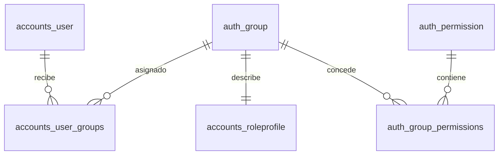

# Cobertura espectral, resultados y roles

## Ejecución local

Desde la raíz `ForestGuard`, PostgreSQL continúa en Docker:

```powershell
docker compose up -d --wait db
```

Consola de API:

```powershell
cd backend
& .\.venv\Scripts\Activate.ps1
py manage.py migrate
py manage.py runserver
```

Segunda consola, también en `ForestGuard\backend`:

```powershell
& .\.venv\Scripts\Activate.ps1
py manage.py run_analysis_worker
```

Consola web, en `ForestGuard\frontend`:

```powershell
pnpm dev
```

Reinicie el worker después de actualizar el código: los trabajos nuevos usan la
versión instalada en ese proceso. Esta fase no incluye despliegue.

Consulte [calidad y comparaciones](calidad-y-comparaciones.md) para el mínimo de cobertura
del 60 %, la política temporal y los cambios del selector y PDF.

## Método confirmado para las categorías

Versión: `forestguard_spectral_rules_v1`, pipeline histórico `v4`. Las reglas son
operativas del proyecto y se calculan independientemente del clasificador v9.
Los índices conservan sus unidades matemáticas; un NDVI de 0,7 **no equivale** a
70 % de bosque. El porcentaje de una categoría es:

`100 × píxeles válidos de la categoría / píxeles válidos evaluados`.

### Una fecha

| Categoría | Regla | Color |
| --- | --- | --- |
| Vegetación de vigor alto | NDVI ≥ 0,5 | Verde |
| Vegetación de vigor bajo / posible pérdida | 0,2 ≤ NDVI < 0,5 | Rojo |
| Otra cobertura / NDVI muy bajo | NDVI < 0,2 | Gris |
| Degradación temporal | Requiere otra fecha; porcentaje `null` | Amarillo en la leyenda |

El límite 0,2 separa el proxy de vegetación de otras superficies para evitar
contar automáticamente agua o suelo como pérdida de bosque. El diagnóstico de
una fecha describe condición, y la comparación identifica cambios. La clase
verde individual se llama vigor alto; no establece estabilidad temporal.

### Dos o más fechas

Se comparan fechas consecutivas, ordenadas cronológicamente. La escena final
se alinea con la cuadrícula inicial. El RGB final y el mapa categórico del
intervalo utilizan esa misma extensión.

El proxy de bosque de referencia es **NDVI inicial ≥ 0,5**. Sobre ese proxy:

1. **Posible deforestación:** NDVI final < 0,5 o pérdida NDVI > 0,3.
2. **Degradación:** pérdida NBR entre 0,1 y 0,4, ambos inclusive, después de
   excluir la categoría anterior.
3. **Bosque estable según proxy:** superficie restante del proxy de referencia.
4. **Otra cobertura:** píxeles válidos que no pertenecían al proxy inicial.

La pérdida se define como **inicial menos final**. Los GeoTIFF técnicos `dNDVI`,
`dNBR`, etc. mantienen su contrato **final menos inicial**; un valor negativo en
esos mapas indica descenso. Se tolera el redondeo float32 de 0,000001 en los
límites de la pérdida temporal.

NDMI y NDRE se conservan como información complementaria sobre humedad y
vegetación. No se les atribuye un umbral de degradación individual que no haya
sido definido. dNBR requiere dos fechas; su interpretación depende del contexto
de cobertura y estación. El v9 se ejecuta desde 35 días, sin máximo, conservando el intervalo de entrenamiento
como metadato. No modifica las categorías de estas reglas.

Las categorías son excluyentes. En una escena se usa su área válida; en un
intervalo, la intersección válida de ambas escenas. NoData es transparente y
queda fuera del denominador. Con cero píxeles evaluables los porcentajes son
`null`, no 0 %. Las áreas requieren CRS proyectado y se expresan además en ha.
Los porcentajes de distintas fechas o intervalos no se suman como terrenos
independientes. El redondeo visual puede producir diferencias de 0,01 % en la suma.

Referencias sobre interpretación y convención de diferencias:
[USGS, glosario dNBR/dNDVI](https://burnseverity.cr.usgs.gov/glossary),
[NASA, NDVI/EVI](https://science.nasa.gov/earth/earth-observatory/measuring-vegetation-ndvi-evi/).
Los valores numéricos anteriores son reglas del proyecto, no umbrales universales
certificados por esas fuentes.

## Flujo de resultados

1. Crear o seleccionar un área en la web o `POST /api/v1/study-areas/`.
2. Subir el GeoTIFF con `POST /api/v1/images/`, `multipart/form-data`. El
   servidor detecta fecha, bandas y escala. Conservar el ID devuelto.
3. Crear el análisis con área e `image_ids`. Una fecha calcula condición e índices
   automáticamente. Dos o más permiten comparar fechas; v9 sigue siendo opcional
   en la API y requiere compatibilidad. La web selecciona el modelo activo para
   varias fechas, según el flujo existente.
4. Mantener el worker abierto y consultar el estado real. No se simulan porcentajes
   ni tiempos de procesamiento.
5. Al completar, abrir **Imagen original y resultado**. El selector permite
   cambiar entre fechas e intervalos, con tarjetas de porcentaje y superficie.
6. Descargar el ZIP PNG, TIFF o ambos; también están disponibles los índices y
   el informe PDF. Los IDs de artefactos se gestionan internamente en la web.

El backend publica en `summary.escenas[].condicion` y
`summary.intervalos[].condicion`: versión, reglas, denominador, cobertura válida,
área, conteos y categorías (`clave`, `valor`, `etiqueta`, `color`, `pixeles`,
`porcentaje`, `area_ha`). Ese objeto es la fuente de las tarjetas, mapas y PDF.
Los campos históricos `superficie`, `deforestacion_observada` y
`degradacion_observada` conservan su compatibilidad; no se deben confundir con
la nueva clasificación conjunta. El raster legado de degradación usa ahora
la misma regla NBR y prioridad que `condicion`.

### Archivos por fecha e intervalo

| Archivo | Contenido |
| --- | --- |
| `condicion_bosque.tif` | Clases georreferenciadas: 0 otra cobertura, 1 vigor alto/estable, 2 degradación temporal, 3 posible pérdida, 255 NoData |
| `condicion_bosque.png` | Mapa categórico en colores, con transparencia NoData |
| `original_rgb.png` | RGB individual B4/B3/B2, solo en fechas |
| `original_final_rgb.png` | RGB final alineado al intervalo, solo en comparaciones |
| `mapas_original_resultado.png` | Original y resultado separados en la misma lámina |
| `resumen_condicion.png` | Dos mapas, leyenda y porcentajes |
| `NDVI/NDMI/NBR/NDRE.tif/png` | Índices técnicos individuales |
| `dNDVI/dNDMI/dNBR/dNDRE.tif/png` | Diferencias técnicas por intervalo |

Se conservan las láminas de índices en las dos paletas y las comparativas.
El ZIP incluye `png/`, `tiff/`, `resumen_serie.json`, `reporte.pdf` y una guía.
Todos los archivos requieren autenticación y propiedad del análisis.

El PDF incluye identidad del análisis, cobertura válida, resumen del último
periodo (no una suma), secciones por fecha e intervalo con mapas, porcentajes,
interpretación y media/mediana/p10/p90. La sección de método y trazabilidad se retiró del PDF; sus datos permanecen en JSON. Usa colores y
cabecera ForestGuard. La interpretación se redacta a partir de las métricas
calculadas, sin inventar exactitud, confianza ni probabilidades.

Los análisis previos conservan sus archivos y versión. Para aplicar las nuevas
reglas se crea un **nuevo análisis con las mismas imágenes**; no se reescribe el
historial de forma implícita. El comando de backfill de PNG sigue disponible,
pero no recalcula categorías en análisis anteriores.

## Roles y permisos normalizados

La relación SQL propuesta `rol`/`user_rol` se implementa con las relaciones
equivalentes de Django:



No se ejecuta el SQL del esquema inicial ni se duplican usuarios o contraseñas.
`accounts.0002_roles` conserva las cuentas y vincula su rol anterior con un
grupo. `RoleProfile` añade descripción y protección de roles base.

- **admin:** administración de usuarios/roles y módulos del proyecto.
- **analyst:** áreas, imágenes y análisis propios; consulta de modelos.
- **Personalizados:** selección de permisos por módulo; un usuario puede
  recibir varios roles. Sus permisos se combinan.
- Los permisos adicionales de Django y el superusuario mantienen su semántica.
- Ser administrador de la API no concede automáticamente `is_staff` ni acceso
  al panel `/admin/` de Django. Ese panel conserva los controles de Django.

`role` se mantiene como campo de compatibilidad para clientes anteriores.
La autorización usa grupos/permisos, no comparaciones contra ese string.
`GET /api/v1/auth/me/` y el listado de usuarios devuelven `roles` y
`permissions`. La web consulta esas capacidades para rutas y navegación;
el backend vuelve a comprobarlas en cada petición.

El catálogo expone 18 permisos de operaciones soportadas por los endpoints actuales;
los permisos estándar de Django para acciones sin endpoint no se ofrecen al crear roles personalizados.

### Endpoints y uso

| Operación | Ruta | Permiso |
| --- | --- | --- |
| Listar / consultar roles | `GET /api/v1/admin/roles/` y `{id}/` | `auth.view_group` |
| Crear rol | `POST /api/v1/admin/roles/` | `auth.add_group` |
| Editar rol y permisos | `PATCH /api/v1/admin/roles/{id}/` | `auth.change_group` |
| Eliminar rol sin usuarios | `DELETE /api/v1/admin/roles/{id}/` | `auth.delete_group` |
| Catálogo de permisos | `GET /api/v1/admin/permissions/` | `auth.view_group` |
| Asignar roles | `PATCH /api/v1/admin/users/{id}/` con `role_ids` | `accounts.change_user` + `auth.change_group` |

Ejemplo de rol (IDs obtenidos del catálogo; la web presenta nombres):

```json
{"name": "revisor", "description": "Revisión de estudios", "permission_ids": [1, 2]}
```

Los IDs anteriores son ilustrativos: no se deben copiar sin consultar el catálogo.
Asignación de varios roles:

```json
{"role_ids": [3, 4]}
```

No enviar `role` y `role_ids` juntos. Un arreglo vacío retira todos los roles;
el usuario conserva su cuenta y perfil, pero no gana acceso a módulos.
Para usar pantallas de edición, conceder también la consulta del módulo. Para
crear análisis desde la web se necesitan consulta de áreas/imágenes/modelos y
creación de análisis; conceder creación de áreas e imágenes si debe cargarlos.

Protecciones: registro/perfil no permiten elevar permisos, asignación de roles
exige permiso adicional, roles base no se eliminan ni cambian sus permisos,
un rol asignado no se elimina, el administrador no se desactiva ni se degrada a
sí mismo y debe permanecer al menos un administrador activo. Los permisos de
módulo se combinan con filtros por propietario: un administrador no obtiene por
ello acceso a archivos personales ajenos. Los permisos revocados afectan las
siguientes solicitudes, incluso con un JWT anterior. Recargar la web actualiza
las capacidades mostradas en la sesión.

## Verificación

Las pruebas usan base PostgreSQL y media aislados. Incluyen fronteras de los
umbrales, prioridad y ausencia de doble conteo; NoData, porcentajes, colores,
GeoTIFF/PNG/ZIP/PDF; CRUD/asignación/revocación de roles y privacidad.

```powershell
# backend, entorno activado
py -m pytest -q --tb=short
py -m ruff check accounts analyses backend tests pipeline/src/forest_condition.py pipeline/src/forestguard_pipeline.py
py manage.py makemigrations --check --dry-run
py manage.py check

# Navegador real con pipeline y base aislada
$env:FORESTGUARD_BROWSER_TEST='1'
py -m pytest tests/test_frontend_e2e.py -q --tb=short --reuse-db

# frontend
pnpm lint
pnpm test
pnpm build
```

El script de navegador refleja el asistente actual de cuatro pasos. Comprueba
registro/login, sesión al recargar, perfil, carga aceptada/rechazada, individual,
comparación con v9, fallos controlados, mapas privados, exportaciones, CRUD,
administración, roles, teclado y tamaños móviles.

### Resultado de esta fase (24 de octubre de 2026)

- Suite completa: **32 pruebas aprobadas**, activando navegador y TIFF reales.
- Par real comprobado: **2019-01-01 a 2019-02-10**, con v9 ejecutado.
- Pruebas del cliente HTTP: **4 aprobadas**; lint y build del frontend correctos.
- Ruff, `manage.py check`, consistencia de migraciones y OpenAPI con
  `--validate --fail-on-warn`: correctos.
- PDF individual y comparativo renderizados y revisados visualmente; detalle
  técnico y métricas de v9 permanecen junto a los mapas, sin páginas huérfanas.
- Migración local de roles aplicada conservando cuentas, áreas, escenas y análisis.
- El TIFF 2025-12-15 suministrado anteriormente no contiene reflectancia válida;
  su rechazo confirma el control de calidad de entrada. No se utiliza para la
  comprobación de inferencia con datos válidos.

Rama de trabajo: `feature/results-classification-and-roles`, desde `dev` en
`4315d16`. Los cambios de esta fase se conservan en commits locales.
